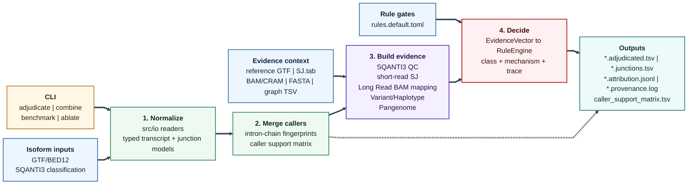

# Architecture

PanIsoGuard is an **adjudication layer**: it consumes the output of long-read
isoform callers (and SQANTI3) plus optional evidence inputs, and re-classifies each
*novel* isoform into a confidence class with a mechanistic attribution and a
provenance/circularity flag. It does not call isoforms and does not recompute
SQANTI3's QC features.

The codebase (C++17, htslib-only) is organized into **five layers**, from the user
boundary inward:

## Map



## 1. CLI layer

User-facing subcommands, dispatched samtools-style from
[`src/cli/main.cpp`](../src/cli/main.cpp):

| Command | Source | Purpose |
|---------|--------|---------|
| `adjudicate` | [`cmd_adjudicate.cpp`](../src/cli/cmd_adjudicate.cpp) | classify novel isoforms → 3 output files |
| `benchmark`  | [`cmd_benchmark.cpp`](../src/cli/cmd_benchmark.cpp) | non-redundancy vs the SQANTI3 filter |
| `ablate`     | [`cmd_ablate.cpp`](../src/cli/cmd_ablate.cpp) | per-evidence-axis contribution |
| `combine`    | [`cmd_combine.cpp`](../src/cli/cmd_combine.cpp) | integrate multiple callers by intron-chain fingerprint |

Argument parsing and the shared load-and-run path live in
[`run_common.cpp`](../src/cli/run_common.cpp) so `adjudicate`/`benchmark`/`ablate`
take an identical input set.

## 2. Input reader layer

In-house parsers (no external parsing deps) under [`src/io/`](../src/io/):

- **SQANTI3 classification** (`sqanti_reader.cpp`) — name-indexed columns, tolerant
  to SQANTI3's appended filter columns.
- **Caller isoforms** — BED12 (`bed12_reader.cpp`) or GTF (`gtf_reader.cpp`).
- **Reference GTF** → known-intron/known-transcript catalog (`gtf_reader.cpp`).
- **STAR `SJ.tab`** (`sj_tab_reader.cpp`) — short-read splice junctions.
- **Pangenome junctions** (`pangenome_reader.cpp`) — graph-haplotype-supported junctions.
- **BAM/CRAM** (`src/evidence/bam_features.cpp`, htslib) and **haplotype FASTA**
  (`src/evidence/variant_motif.cpp`, htslib `faidx`) are opened lazily by the
  evidence layer.

## 3. Core data model

Every transcript structure is normalized into a **0-based half-open intron chain**
([`include/panisoguard/types.hpp`](../include/panisoguard/types.hpp): `Junction`,
`IntronChain`, `Strand`). This single convention lets `SJ.tab`, GTF, BED12, and
pangenome coordinates be compared by exact equality. Equivalently, the intron chain is
a **path through a gene-local splice graph** and the reference catalog is the **known
graph**; that framing is in [method_graph.md](method_graph.md). Two derived structures:

- **Intron-chain fingerprint** (`src/core/fingerprint.cpp`) — an FNV-1a hash over
  `chrom + strand + sorted introns`; used by `combine` to merge isoforms across
  callers that use different running-ID schemes.
- **Interval index** (`src/core/interval_index.cpp`) — RAII wrapper over a vendored
  cgranges interval tree for fast overlap queries.

## 4. Evidence layer

Given a novel junction, each axis produces an orthogonal, independently-skippable
signal (absent input ⇒ the axis is *not_evaluable*, never silently treated as
for/against):

| Axis | Module | Signal |
|------|--------|--------|
| Short-read SJ | `SjTable::find_exact` | the junction is corroborated by STAR `SJ.tab` |
| Long-read BAM | `BamReader::features_at_junction` | read-level spanning / MAPQ / soft-clip / indel features |
| SQANTI priors | (read from the classification) | RTS_stage, all_canonical, perc_A_downstream_TTS |
| Variant motif | `HaplotypeProvider::classify` | a splice motif created/destroyed on a personalized haplotype |
| Pangenome | `PangenomeJunctions::supports` | the junction is realizable on a pangenome graph path |

All signals are assembled into one `EvidenceVector`
([`verdict.hpp`](../include/panisoguard/verdict.hpp)) per isoform by the adjudicator
([`src/core/adjudicator.cpp`](../src/core/adjudicator.cpp)).

## 5. Decision layer

The `RuleEngine` ([`src/core/rules.cpp`](../src/core/rules.cpp)) is a **deterministic**
projection of the `EvidenceVector` onto a `Verdict` (confidence class + primary
mechanism + circularity flag + `rule_trace`). Thresholds live in a runtime
[`config/rules.default.toml`](../config/rules.default.toml); the projection logic and
the reference-bias circularity firewall are documented in
[decision_engine.md](decision_engine.md).

## Data flow

```text
inputs ─► [readers] ─► SqantiTable + {id→IntronChain} + Catalog + (SjTable/BAM/Haplotype/Pangenome)
                              │
                              ▼
                    [adjudicator] per isoform: novel-junction detection + evidence collection
                              │
                              ▼
                    EvidenceVector ─► [RuleEngine.evaluate] ─► Verdict
                              │
                              ▼
              .adjudicated.tsv / .junctions.tsv / .attribution.jsonl (rule_trace + graph_trace) / .provenance.log
```

## Design properties

- **Deterministic + auditable** — every verdict carries a `rule_trace` listing the
  rules that fired; no randomness in the decision path.
- **Orthogonal axes** — each evidence axis is optional and can be masked individually
  (`ablate`), so a run with only SQANTI priors still produces honest verdicts.
- **Circularity firewall** — a rescue that would rest on the sample's own RNA-derived
  data is held `UNRESOLVED`, not promoted (variant and pangenome axes both gated).
- **htslib-only** — the sole non-vendored dependency; cgranges / toml++ / Catch2 are
  vendored single-header components.
